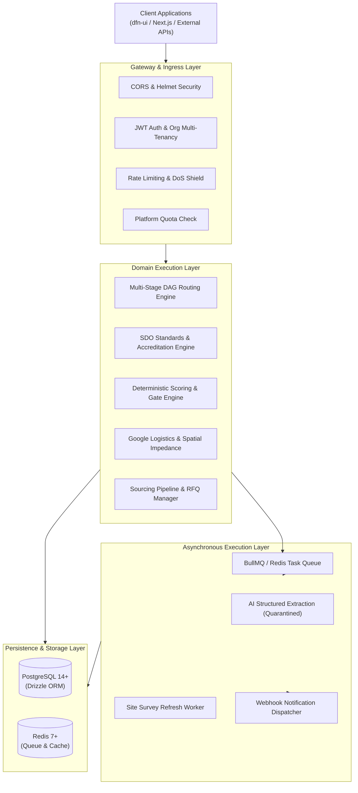

# System Architecture & Core Concepts

DFN Discovery is architected as a layered, modular system designed for determinism, resilience, and strict multi-tenant isolation. 



---

## 1. Architectural Principles

1. **Deterministic Intelligence**: 
   Scoring algorithms, capability evaluations, and route selections must produce identical, auditable results for identical inputs. AI is used solely for parsing unstructured text or summarizing audit documents. All business logic is evaluated deterministically.
2. **Non-Compensatory Quality Gates**: 
   High performance in one metric (e.g., low freight cost) cannot compensate for a failure in a mandatory physical constraint (e.g., machine bed envelope, required tolerance, or lack of mandatory ISO/SON certification). Bottlenecks immediately disqualify or penalize the routing chain.
3. **Strict Multi-Tenancy**: 
   Every persistent record (`jobs`, `quotes`, `projects`, `routing_runs`) is partitioned by `org_id`. Cross-tenant queries are blocked at both the middleware and database abstraction layers.
4. **Spatial Impedance Awareness**: 
   Logistics calculations in emerging manufacturing markets cannot assume linear geodesic distances. Route feasibility incorporates road surface conditions, interstate transit delays, security checkpoints, and transshipment preservation costs.

---

## 2. Layered Architecture

### A. Ingress & Security Layer
- **Raw Body Buffer**: Mounted specifically for `/webhooks` endpoints before general JSON parsers to facilitate HMAC-SHA256 signature verification (SafetyCulture and UpKeep integrations).
- **Helmet & CORS**: Strict HTTP header sanitization and domain allowlisting.
- **JWT Authentication (`auth.ts`)**: Decodes RS256 JWTs against Auth0/Keycloak endpoints, extracts tenant claims (`orgId`, `roles`, `quotas`), and binds them to `res.locals.auth`.
- **Rate Limiting (`rate-limiter.ts`)**: Tiered window rate limiters (60 req/15min for sensitive auth/verification operations, 100 req/15min for webhooks, 300 req/15min for general API traffic).
- **Quota Middleware (`quota.ts`)**: Validates active subscription tiers and job analysis allowances against the central billing platform before triggering expensive pipelines.

### B. Domain Services Layer
- **DAG Routing Service (`dag-routing-service.ts`)**:
  Decomposes manufacturing requirements into a Directed Acyclic Graph of individual process stages (e.g., Casting $\rightarrow$ Rough Machining $\rightarrow$ Heat Treatment $\rightarrow$ CNC Finish $\rightarrow$ Coating). It resolves cluster candidate combinations, enforces bottleneck gates, and computes the geometric mean score across all stages.
- **Standards & SDO Service (`standards-service.ts`)**:
  Maintains the multi-SDO registry covering SON (Standards Organisation of Nigeria), ISO, ASTM, ASME, API, DIN, and IEC. Provides bidirectional equivalence resolution to identify local Nigerian equivalents (e.g., mapping ASTM A36 to NIS 117) and verifies factory accreditations against IAF CertSearch databases.
- **Geo-Logistics Service (`geo-logistics.ts`)**:
  Interfaces with Google Location Services (Geocoding API, Distance Matrix API, Directions API) with built-in Nigerian geo-biasing, transit speed limits, and road condition penalty multipliers.
- **Scoring & Evaluation Core (`core-intelligence.ts`, `scoring-service.ts`)**:
  Implements multi-attribute utility theory evaluating process capability, machine envelope compatibility, materials availability, quality history, and capacity bands.

### C. Worker & Queue Subsystem
- **Job Queue (`workers/queue.ts`)**:
  Manages asynchronous, background, and long-running execution tasks. Supports automatic retry with exponential backoff ($T_{\text{delay}} = \min(60\text{s}, T_{\text{initial}} \times 2^{\text{attempts}})$), job timeouts, concurrency limits, and webhook event publishing.
- **AI Worker (`ai-analysis-workers.ts`)**:
  Isolates calls to OpenAI, Anthropic, or Google Gemini through unified adapters. Implements strict system prompt isolation to prevent prompt injection vulnerabilities (CWE-1427).

### D. Persistence Layer
- **PostgreSQL 14+**:
  Relational data store managed through Drizzle ORM. Enforces foreign key constraints, JSONB validation, and index optimization across multi-tenant queries.
- **Redis 7+**:
  In-memory data store supporting rate-limit tracking, session state, fast-path negative quota caching, and task queue management.

---

## 3. Request Lifecycle

The standard request lifecycle follows a disciplined pipeline:

```
HTTP Request
     │
     ▼
[Express Raw Body Check] ──► (If webhook: capture Buffer for HMAC)
     │
     ▼
[CORS & Helmet Policy]
     │
     ▼
[JSON / URL-Encoded Parsing]
     │
     ▼
[JWT Authentication] ──────► Validates token, attaches res.locals.auth = { orgId, ... }
     │
     ▼
[Quota Verification] ──────► Checks Redis cache / billing service for remaining quota
     │
     ▼
[Rate Limiting] ───────────► Shields endpoint from brute-force / DoS
     │
     ▼
[Route Controller] ────────► Validates input schemas (e.g., Zod or manual boundary checks)
     │
     ▼
[Domain Service] ──────────► Executes business logic & queries Drizzle ORM
     │
     ▼
[HTTP Response / Queue] ───► Returns JSON result or enqueues async background task
     │
     ▼
[Error Middleware] ────────► Intercepts AppError, maps HTTP status codes, masks internals
```

---

## 4. Multi-Tenant Data Isolation

Data isolation between client organizations is enforced using strict column-level multi-tenancy:
- All core business entities (`jobs`, `quotes`, `projects`, `routing_runs`) contain an indexed `org_id` column.
- Route controllers extract `orgId` exclusively from verified JWT token context (`res.locals.auth.orgId`). Client-supplied route parameters or body parameters cannot override the token identity.
- Database query helpers (`src/db/queries.ts`) require `orgId` as an explicit parameter and append `eq(table.org_id, orgId)` to all `SELECT`, `UPDATE`, and `DELETE` queries.
