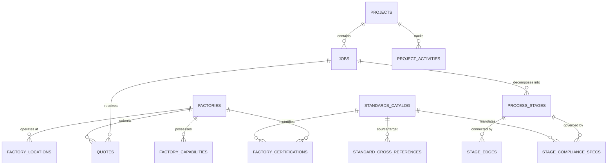

# Database Architecture & Schema Reference

DFN Discovery uses **PostgreSQL 14+** managed through **Drizzle ORM**. This reference documents the relational data model, table structures, column definitions, constraints, indexes, and multi-tenant query conventions.

---

## 1. Entity-Relationship Overview



---

## 2. Core Domain Tables

### `jobs`
Stores manufacturing job intakes and RFQs.

| Column | Type | Constraints | Description |
| :--- | :--- | :--- | :--- |
| `id` | `uuid` | Primary Key, `defaultRandom()` | Unique job identifier. |
| `org_id` | `text` | Not Null, Indexed | Tenant organization identifier. |
| `project_id` | `uuid` | Foreign Key $\rightarrow$ `projects.id` | Optional parent sourcing project. |
| `rfq_code` | `text` | Unique, Indexed | Human-readable RFQ reference (e.g. `RFQ-2026-001`). |
| `company_name` | `text` | Not Null | Requesting enterprise or client company. |
| `product_name` | `text` | Not Null | Name of manufactured part or assembly. |
| `stage` | `text` | Not Null, Default: `'open'` | Sourcing pipeline stage (`open`, `review`, `commit`). |
| `status` | `text` | Not Null, Default: `'draft'` | Job lifecycle status (`draft`, `submitted`, `scored`, `recommended`, `published`, `archived`, `analysis_failed`). |
| `version` | `integer`| Not Null, Default: `1` | Optimistic concurrency control version. |
| `location` | `jsonb` | Not Null | Job destination coordinates (`latitude`, `longitude`, `country`, `state`, `city`). |
| `bop` | `jsonb` | Nullable | Bill of Process JSON specification containing process stages. |
| `target_price_max`| `numeric`| Nullable | Client target maximum budget in NGN. |
| `target_lead_days`| `integer`| Nullable | Required delivery timeline in days. |
| `created_at` | `timestamp`| Default: `now()` | Timestamp of initial intake. |
| `updated_at` | `timestamp`| Default: `now()` | Timestamp of last modification. |

### `factories`
Registry of vetted Nigerian manufacturing facilities.

| Column | Type | Constraints | Description |
| :--- | :--- | :--- | :--- |
| `id` | `uuid` | Primary Key, `defaultRandom()` | Unique factory UUID. |
| `factory_name` | `text` | Not Null | Registered business or operational facility name. |
| `verification_status`| `text`| Default: `'unverified'` | Audit status (`verified`, `provisional`, `unverified`). |
| `active` | `boolean` | Default: `true` | Operational availability toggle. |
| `contact_email` | `text` | Nullable | Facility primary dispatch contact. |
| `metadata` | `jsonb` | Default: `{}` | Unstructured metadata and external survey attributes. |
| `created_at` | `timestamp`| Default: `now()` | Registration date. |

### `factory_locations`
Physical operating locations and industrial clusters.

| Column | Type | Constraints | Description |
| :--- | :--- | :--- | :--- |
| `id` | `uuid` | Primary Key, `defaultRandom()` | Unique location identifier. |
| `factory_id` | `uuid` | Foreign Key $\rightarrow$ `factories.id` | Associated factory. |
| `country` | `text` | Not Null, Default: `'NG'` | Country code. |
| `state` | `text` | Not Null | Nigerian state (e.g. `Lagos`, `Ogun`, `Anambra`, `Rivers`, `Kano`). |
| `city` | `text` | Not Null | Industrial cluster or city (e.g. `Ikeja`, `Aba`, `Nnewi`). |
| `latitude` | `doublePrecision`| Not Null | Geographic latitude. |
| `longitude` | `doublePrecision`| Not Null | Geographic longitude. |

### `quotes`
Supplier bids and commercial proposals.

| Column | Type | Constraints | Description |
| :--- | :--- | :--- | :--- |
| `id` | `uuid` | Primary Key, `defaultRandom()` | Unique quote UUID. |
| `job_id` | `uuid` | Foreign Key $\rightarrow$ `jobs.id` | Target job. |
| `factory_id` | `uuid` | Foreign Key $\rightarrow$ `factories.id` | Quoting facility. |
| `unit_price_ngn` | `numeric` | Not Null | Commercial price per unit in Nigerian Naira. |
| `lead_time_days` | `integer` | Not Null | Confirmed manufacturing duration. |
| `awarded` | `boolean` | Default: `false` | Set to `true` when contract is awarded. |
| `awarded_at` | `timestamp`| Nullable | Timestamp of award execution. |
| `status` | `text` | Default: `'received'` | Quote status (`received`, `shortlisted`, `awarded`, `rejected`). |
| `created_at` | `timestamp`| Default: `now()` | Bid submission date. |

---

## 3. Standards & Compliance Tables

### `standards_catalog`
Central registry of technical standards.

| Column | Type | Constraints | Description |
| :--- | :--- | :--- | :--- |
| `id` | `text` | Primary Key | Canonical identifier (e.g. `son-nis-117` or `astm-a36`). |
| `sdo` | `text` | Not Null, Indexed | SDO acronym (`SON`, `ISO`, `ASTM`, `ASME`, `API`, `DIN`, `IEC`). |
| `standard_number` | `text` | Not Null, Unique, Indexed | Standard code (e.g. `NIS 117`, `ASTM A36`, `ISO 9001:2015`). |
| `title` | `text` | Not Null | Official gazetted title. |
| `edition_year` | `integer` | Nullable | Publication year. |
| `is_mandatory_nigerian`| `boolean`| Default: `false` | Whether SON mandates this standard within Nigeria. |
| `gazette_reference`| `text` | Nullable | Official Federal Government Gazette reference number. |

### `standard_cross_references`
Bidirectional equivalences between international and domestic standards.

| Column | Type | Constraints | Description |
| :--- | :--- | :--- | :--- |
| `id` | `uuid` | Primary Key, `defaultRandom()` | Cross-reference identifier. |
| `source_standard_id`| `text` | Foreign Key $\rightarrow$ `standards_catalog.id` | Foreign/International standard. |
| `target_standard_id`| `text` | Foreign Key $\rightarrow$ `standards_catalog.id` | Domestic Nigerian NIS standard. |
| `equivalence_type` | `text` | Not Null | Relationship: `identical`, `equivalent`, `superseded`, `partial`. |
| `technical_notes` | `text` | Nullable | Comparison notes and material grade mappings. |

### `factory_certifications`
Accreditations held by manufacturing facilities.

| Column | Type | Constraints | Description |
| :--- | :--- | :--- | :--- |
| `id` | `uuid` | Primary Key, `defaultRandom()` | Certification record UUID. |
| `factory_id` | `uuid` | Foreign Key $\rightarrow$ `factories.id` | Accredited factory. |
| `standard_id` | `text` | Foreign Key $\rightarrow$ `standards_catalog.id` | Associated standard. |
| `certificate_number`| `text` | Not Null | Certificate registry number. |
| `verification_status`| `text`| Default: `'unverified'` | Status: `unverified`, `pending`, `verified`, `expired`. |
| `is_iaf_verified` | `boolean` | Default: `false` | Whether validated against IAF CertSearch database. |
| `iaf_cert_search_id`| `text` | Nullable | Unique IAF CertSearch reference. |
| `valid_from` | `timestamp`| Not Null | Issue date. |
| `valid_to` | `timestamp`| Not Null | Expiration date. |

---

## 4. Multi-Stage Routing Tables

### `process_stages`
Decomposed operations belonging to a manufacturing job.

| Column | Type | Description |
| :--- | :--- | :--- |
| `id` | `uuid` (PK) | Stage identifier. |
| `job_id` | `uuid` (FK) | Parent manufacturing job. |
| `stage_index` | `integer` | 1-based sequence order in the BOP. |
| `process_type` | `text` | Manufacturing process (e.g. `sand-casting`, `cnc-turning`). |
| `criticality_weight`| `numeric` | Criticality multiplier for geometric mean scoring ($w_i$). |
| `direct_stage_cost_ngn`| `numeric` | Estimated base machining cost. |
| `tooling_cost_ngn` | `numeric` | Estimated setup/tooling cost. |
| `estimated_cycle_time_min`| `numeric`| Estimated duration per unit. |

### `stage_edges`
Handoffs and logistics dependencies between sequential stages.

| Column | Type | Description |
| :--- | :--- | :--- |
| `id` | `uuid` (PK) | Edge identifier. |
| `from_stage_id` | `uuid` (FK) | Origin stage. |
| `to_stage_id` | `uuid` (FK) | Destination stage. |
| `preservation_required`| `boolean` | Anti-rust / environmental protection required during transit. |
| `handoff_state` | `text` | Material condition (e.g. `raw_casting`, `machined_blank`). |

---

## 5. Query Patterns & Tenant Isolation

All queries must enforce tenant isolation using `orgId`.

```typescript
// Pattern: Strictly tenant-isolated SELECT query
export async function getJobsByProject(projectId: string, orgId: string) {
  return db
    .select()
    .from(jobs)
    .where(
      and(
        eq(jobs.project_id, projectId),
        eq(jobs.org_id, orgId) // Mandatory tenant filter
      )
    )
    .orderBy(desc(jobs.created_at));
}
```
All foreign keys to `org_id` are indexed in PostgreSQL to ensure fast plan execution during multi-tenant filtering.
