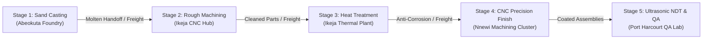
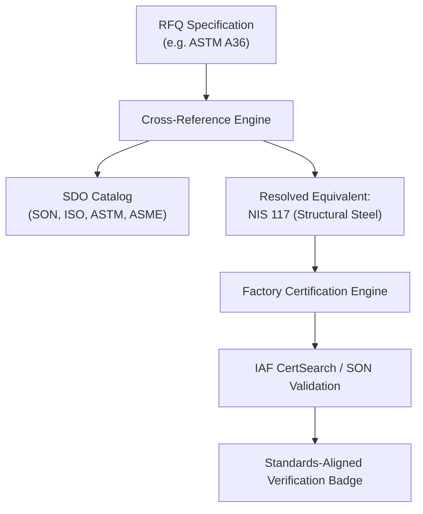

# Domain Services & Business Logic

This document details the core domain engines that power DFN Discovery: multi-stage process routing (DAG), standards and SDO cross-referencing, geo-logistics and spatial impedance, sourcing pipeline intelligence, deterministic capability scoring, and AI provider integration.

---

## 1. Multi-Stage Process Routing Engine (`dag-routing-service.ts`)

In complex discrete manufacturing, a job rarely consists of a single isolated operation. An oilfield flange or industrial pump impeller requires casting, heat treatment, CNC turning/milling, non-destructive testing (NDT), and protective coating.

The **DAG Routing Service** normalizes these operations into a Directed Acyclic Graph (DAG) of process stages and evaluates optimal multi-factory manufacturing clusters across Nigerian industrial hubs.

### A. Graph Representation

- **Stages (`ProcessStageNode`)**: Represents discrete physical manufacturing steps (e.g., `stage_index`, `process_type`, `required_machines`, `tolerance_mm`, `criticality_weight`).
- **Edges (`ProcessStageEdge`)**: Represents dependency constraints and physical handoffs between sequential operations (e.g., `from_stage`, `to_stage`, `handoff_state`, `preservation_required`).



### B. Composite Chain Scoring Formula

To prevent high performance in minor stages from masking failure in critical bottleneck stages, the routing engine aggregates stage fit scores using a **Weighted Geometric Mean with Non-Compensatory Gates and Spatial Impedance**:

$$\text{Score}_{\text{chain}} = \left(\prod_{i=1}^n S_{\text{stage},i}^{w_i}\right)^{\frac{1}{\sum w_i}} \times (1 - \min(0.35, \sum P_{\text{logistics},j}))$$

Where:
- $S_{\text{stage},i}$ is the capability score of the assigned factory for stage $i$ ($0 \le S \le 100$).
- If any mandatory stage has $S_{\text{stage},i} = 0$, the entire chain score evaluates to **$0$** (non-compensatory gate).
- $w_i$ is the criticality weight of process stage $i$.
- $P_{\text{logistics},j}$ is the logistics friction between sequential stages $j \rightarrow j+1$.

### C. Total Landed Cost (TLC) Formulation

The landed cost across a multi-stage cluster aggregates five distinct cost drivers:

$$\text{TLC} = C_{\text{machining}} + C_{\text{tooling}} + C_{\text{freight}} + C_{\text{preservation}} + C_{\text{scrap\_buffer}}$$

1. **Direct Machining Cost ($C_{\text{machining}}$)**: Machine hourly rates multiplied by stage cycle time.
2. **Tooling & Setup Cost ($C_{\text{tooling}}$)**: Dedicated jigs, fixtures, and machine setup hours.
3. **Freight & Inter-Facility Transit ($C_{\text{freight}}$)**: Haulage fees computed by Google Location Services based on road distance and truck classification.
4. **Intermediate Preservation Cost ($C_{\text{preservation}}$)**: Rust prevention, packaging, and desiccant treatments applied when unpainted metal travels across interstate routes.
5. **Statistical Scrap Buffer ($C_{\text{scrap\_buffer}}$)**: 3% buffer on direct costs to absorb multi-stage cumulative tolerance stack-up and handling defect risks.

---

## 2. Standards & SDO Architecture Engine (`standards-service.ts`)

Nigerian manufacturing procurement frequently specifies international standards (ISO, ASTM, ASME, API, DIN, IEC) that may have direct or equivalent domestic specifications gazetted by the **Standards Organisation of Nigeria (SON)**.

The **Standards Service** delivers catalog indexing, equivalence resolution, and factory accreditation verification.



### Key Capabilities
- **SDO Catalog Indexing**: Stores standards metadata including standard number, title, SDO identifier, edition/year, ICS classification, and gazette status.
- **Equivalence Mapping**: Maps standards using four relationship types:
  - `identical`: Direct adoption without deviation.
  - `equivalent`: Technical requirements match with minor regional editorial differences.
  - `superseded`: Prior standard replaced by a modern revision.
  - `partial`: Subsets of tolerances or material compositions match.
- **Accreditation Verification**: Validates factory certifications (`ISO 9001:2015`, `ISO 14001:2015`, `ASME Sec VIII Div 1`, `API Spec Q1`, `NIS/SONCAP`) against IAF CertSearch database identifiers.

---

## 3. Geo-Logistics & Google Location Services (`geo-logistics.ts`)

Accurate spatial calculations are critical for Nigerian supply chains, where straight-line distance misrepresents actual travel time due to road topography and congestion corridors.

### Google Maps Adapters (`src/services/integrations/google/`)

| Adapter | Service Function | Features & Optimizations |
| :--- | :--- | :--- |
| **`google-geocode.adapter.ts`** | Geocodes facility addresses and industrial estate descriptions into lat/lng coordinates. | Biased to Nigeria (`components: { country: 'NG' }`), address normalization. |
| **`google-matrix.adapter.ts`** | Computes multi-facility origin-destination travel distances and durations. | Batched matrix calls, caching, speed-clamp fallbacks. |
| **`google-routing.adapter.ts`** | Returns turn-by-turn routes, corridor classifications, and polyline coordinates. | Heavy vehicle routing profiles, road quality friction multipliers. |
| **`google-isoline.adapter.ts`** | Calculates facility catchment radii (e.g., 2-hour or 4-hour transit zones). | Isochrone approximations with speed-decay heuristics. |

All adapters utilize `google-retry.ts` to implement exponential backoff with jitter on network timeouts or transient Google API rate limits.

---

## 4. Sourcing & Pipeline Intelligence (`sourcing-service.ts`)

The sourcing service manages the operational progression of manufacturing projects from RFQ intake to final contract execution.

- **KPI Aggregation**: Computes real-time project metrics including total awarded spend, open RFQ count, average quote response time, and lead time distributions.
- **Supplier Quote Ranking**: Evaluates inbound factory quotations and awards dynamic ranking badges:
  - `BEST_MATCH`: Highest composite technical and capability score.
  - `LOWEST_COST`: Lowest unit price inclusive of tooling and logistics.
  - `FASTEST_DELIVERY`: Shortest confirmed lead time in calendar days.
- **Contract Award Transition**: Atomically locks awarded quotations, marks competing bids as unawarded, transitions the parent job to `committed` state, and logs audit events to `project_activities`.

---

## 5. Deterministic Scoring Core (`core-intelligence.ts`, `scoring-service.ts`)

The scoring engine evaluates candidate factories against job requirements across five deterministic dimensions:

```
Total Capability Score = (0.35 × Process Fit) 
                       + (0.25 × Machine Envelope) 
                       + (0.20 × Material Availability) 
                       + (0.10 × Quality & Certification) 
                       + (0.10 × Historical Delivery Rate)
```

### Quality & Operational Gating
If a factory fails any of the following mandatory gates, its rank is immediately demoted to `-1` and `gatePassed: false` is recorded:
- **Envelope Gate**: Machine maximum travel ($X, Y, Z$) is smaller than part bounding box dimensions.
- **Material Incompatibility**: Factory does not process the required alloy (e.g., titanium, Hastelloy, 316L stainless steel).
- **Compliance Gate**: Job requires nuclear or aerospace accreditation (e.g., ASME Section III, AS9100) not held by the facility.

---

## 6. AI Provider Layer & Prompt Isolation (`ai-providers/adapter.ts`)

To protect the platform against **System Prompt Injection vulnerabilities (CWE-1427)**, all LLM operations strictly enforce system/user prompt separation:

```typescript
// System prompt remains a strict static constant literal
const SUMMARIZE_SYSTEM_PROMPT = 
  'You are a concise summarization expert. Create clear, factual summaries preserving key details.';

// Dynamic inputs and length constraints are strictly passed as USER messages
const userPrompt = req.maxLength
  ? `Summarize (limit to ${req.maxLength} characters):\n\n${req.content}`
  : `Summarize:\n\n${req.content}`;
```

The unified `AIProviderAdapter` interface supports pluggable backends:
- `OpenAIAdapter`: Models `gpt-4o`, `gpt-4o-mini`.
- `AnthropicAdapter`: Models `claude-3-5-sonnet`, `claude-3-haiku`.
- `GoogleAdapter`: Models `gemini-1.5-flash`, `gemini-1.5-pro` via `@google/genai`.
