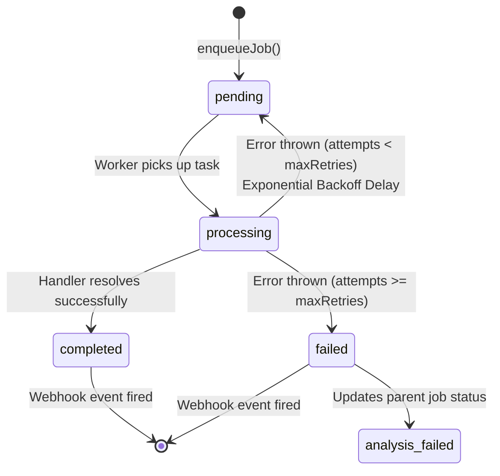

# Asynchronous Workers & Job Queue

DFN Discovery decouples long-running, resource-intensive, and third-party API tasks from the synchronous request-response cycle using an asynchronous **Job Queue Subsystem** (`backend/src/workers/queue.ts`).

---

## 1. Queue Architecture & State Machine

The queue manages task execution with dual persistence support:
- **Redis Backend**: Utilized in production environments to enable distributed worker pools, persistent retry queues, and atomic concurrency limits.
- **In-Memory Fallback**: Automatically used in development and test environments when `REDIS_URL` is absent or unreachable.



### Queue Job Data Structure

```typescript
export interface QueueJob {
  id: string;                     // Unique UUID
  job_id: string;                 // Associated DFN Job UUID
  type: QueueJobType;             // Task identifier
  status: QueueJobStatus;         // 'pending' | 'processing' | 'completed' | 'failed'
  attempts: number;               // Current retry counter
  max_attempts: number;           // Maximum permitted retries (default: 3)
  payload: Record<string, any>;   // Input parameters
  result?: Record<string, any>;   // Output returned by handler
  error?: string;                 // Failure exception message
  created_at: Date;
  started_at?: Date;
  completed_at?: Date;
}
```

---

## 2. Registered Workers & Job Types

| Job Type | Handler Function | Purpose | Timeout | Max Retries |
| :--- | :--- | :--- | :--- | :--- |
| **`refresh-site-brief`** | `handleRefreshSiteBrief` | Ingests SafetyCulture audits or UpKeep CMMS maintenance events to recalculate factory operational risks and machine uptime. | 45s | 3 |
| **`extract-job-details`** | `handleJobExtraction` | Invokes the quarantined LLM adapter to parse unstructured RFQ documents into a structured Bill of Process (BOP). | 60s | 2 |
| **`score-factory-candidate`** | `handleCandidateScoring` | Computes capability fit scores across candidate factories for a specific process stage. | 30s | 3 |
| **`analyze-cad-drawing`** | `handleCadAnalysis` | Parses 2D/3D technical drawings for bounding box, GD&T tolerances, and material callouts. | 90s | 2 |

---

## 3. Resilience, Retries & Exponential Backoff

When a worker handler throws a transient exception (such as an external API timeout or temporary database connection blip), the queue schedules a delayed retry using exponential backoff:

$$T_{\text{delay}} = \min(T_{\text{max}}, T_{\text{initial}} \times 2^{\text{attempts}})$$

Where:
- $T_{\text{initial}} = 2\text{ seconds}$
- $T_{\text{max}} = 60\text{ seconds}$
- Sequence: $2\text{s} \rightarrow 4\text{s} \rightarrow 8\text{s} \rightarrow 16\text{s} \dots \text{capped at } 60\text{s}$.

### Permanent Failure Handling
If `attempts >= max_attempts`, the queue:
1. Sets `queue_job.status = 'failed'`.
2. Records the terminal stack trace in `queue_job.error`.
3. If the queue job is critical to RFQ intake, transitions the parent manufacturing job to `status: 'analysis_failed'`.
4. Dispatches failure notifications to registered webhook listeners.

---

## 4. Webhook Dispatching (Event Subscriptions)

External systems and frontend clients can register webhook listeners to receive asynchronous completion events:

```typescript
// Registering a webhook subscriber
await registerWebhook('job-uuid-123', 'https://erp.client.com/webhooks/dfn-events');
```

When a queue task completes or permanently fails, the queue executes a fire-and-forget HTTP `POST` dispatch:

```json
{
  "event": "queue_job_completed",
  "queueJobId": "qj-9842",
  "jobId": "job-uuid-123",
  "type": "refresh-site-brief",
  "status": "completed",
  "result": {
    "siteBriefUpdated": true,
    "newRiskScore": 12.5
  },
  "timestamp": "2026-10-30T22:50:00.000Z"
}
```
All webhook dispatches run non-blocking in parallel with connection timeouts to ensure client failures do not stall the worker thread.
